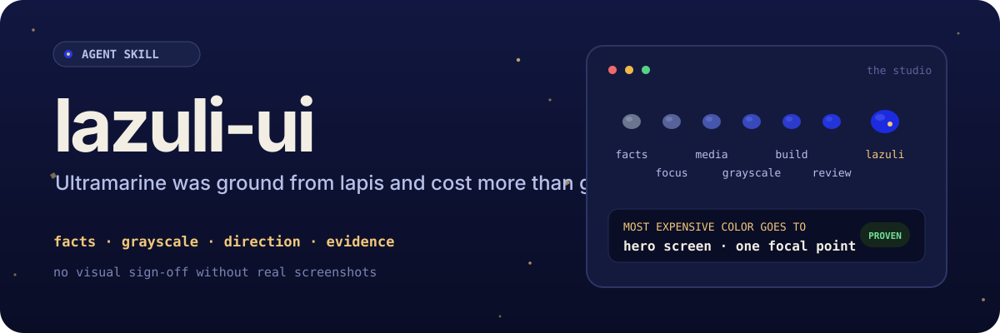

<p align="center">
  
</p>

<p align="center">
  <a href="./README.zh-CN.md">简体中文</a>
</p>

`lazuli-ui` is an Agent Skill for design judgment: it explores directions, builds side-by-side comparison pages, and polishes visual hierarchy against real screenshots — then delivers a comparison page, a design spec, a mockup, or a running interface.

Lazuli is lapis lazuli, the stone ultramarine was ground from — a pigment once worth more than gold. The method spends it the same way: the most expensive choices go to what users see first, and every stage earns its color.

```text
product facts → hero & action → media / concept → grayscale structure → build → real-screenshot review
```

## What it does

- Sets a one-line design north star first, then makes typography, spacing, and color serve it — turning vague words like "premium" into concrete decisions
- Defaults to one recommended direction; on explicit request, generates clearly different directions onto one comparison page (desktop/mobile toggle, keyboard navigation, select-to-copy) — a single offline HTML file
- Draws the grayscale structure of the main viewport before any color; if the structure or core interaction fails, it goes back instead of hiding it behind visuals
- Takes evidence seriously: `shoot.mjs` renders in an isolated temp browser at real viewports, runs interaction steps, and lints the result (contrast below 3:1, text under 11px, tight CJK line height, content stuck transparent, horizontal overflow) into `report.json` — **no visual sign-off without looking at real screenshots**
- Dispatches a fresh-context reviewer subagent with screenshots, task, and constraints only — never source code or prior scores — plus a UX walker that gets no expected path
- Curates real assets (textures, museum collections, NASA, maps) with license tracking via `curate-media.mjs`, instead of fake placeholders
- Keeps process files in `.lazuli-ui/<task>/` and checks deliveries so nothing workspace-related leaks into production code

## Install

```bash
git clone https://github.com/rufus-fan/lazuli-ui.git ~/.agents/skills/lazuli-ui
```

If your client uses another skills directory, clone it there. The entry point is `SKILL.md`.

## Requirements

- Core flow: none — host-neutral text process
- Screenshot evidence: Node 22+ and a local Chrome / Chromium / Edge
- Comparison page generator: Python 3.10+ (standard library only)
- Optional: host-provided image generation for mockup-first workflows

## Repository layout

| Path | Purpose |
| --- | --- |
| `SKILL.md` | Entry point: main flow, scope routing, review protocol |
| `references/` | Design methodology, loaded on demand per topic |
| `scripts/shoot.mjs` | Screenshots, interaction steps, motion frames, readability lint |
| `scripts/build_explorer.py` | Offline multi-direction comparison page |
| `scripts/curate-media.mjs` | Search and fetch real, licensed assets |
| `scripts/measure_reference.py` | Measure real colors and proportions from reference images |
| `assets/style-explorer.html` | Template embedded into comparison pages |

## License

[MIT](./LICENSE)
