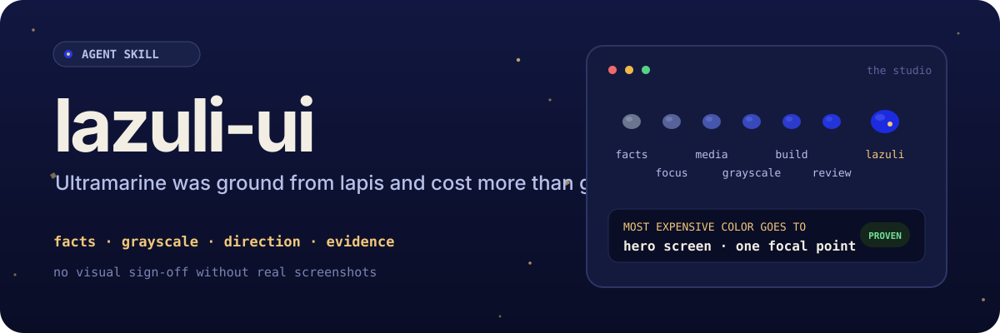

<p align="center">
  
</p>

<p align="center">
  <a href="./README.md">English</a>
</p>

`lazuli-ui` 是一个做设计判断的 Agent Skill：探索设计方向、生成多风格同屏对比页、基于真实截图打磨视觉层级；按请求交付对比页、设计说明、设计稿或可运行界面。

Lazuli 即青金——群青颜料的来源，曾比黄金更贵。这里的方法也一样花这笔最贵的颜色：最重要的决策给用户最先看见的地方，而每一个阶段都要挣得自己的颜色。

```text
产品事实 → 主角/动作 → 素材/概念 → 灰度结构 → 实现 → 真实画面评审
```

## 它做什么

- 先定一句设计北极星，再让排版、留白和配色都为它服务——把「高级」「干净」这类模糊词逼成具体决策
- 默认只推荐一个方向；用户明确要求比较时，把差异明显的多个方向放进同一个对比页（桌面/移动切换、方向键浏览、点击选择）——产物是单个可离线打开的 HTML
- 先画主视口的灰度结构再上颜色；结构或核心交互走不通就退回，不用颜色、字体或主视觉遮过去
- 认真对待证据：`shoot.mjs` 在独立临时浏览器里按真实视口渲染、执行交互步骤，并对结果做可读性检查（对比度低于 3:1、字号小于 11px、中文行高过紧、内容停在透明状态、横向溢出），写进 `report.json`——**没看真实截图，不算视觉验收**
- 派发无历史上下文的评审子 Agent，只给截图、任务和约束——不给源代码、不给上一次的评分；另有不提供预期路径的 UX 走查
- 用 `curate-media.mjs` 检索真实素材（材质库、博物馆馆藏、NASA、古地图），自动记录许可与署名，不用假占位图糊弄
- 过程文件放在 `.lazuli-ui/<任务名>/`，交付前检查，工作区内容不会漏进正式代码

## 安装

```bash
git clone https://github.com/rufus-fan/lazuli-ui.git ~/.agents/skills/lazuli-ui
```

如果你的客户端使用其他 Skill 目录，请克隆到对应位置。入口文件是 `SKILL.md`。

## 运行要求

- 核心流程：无依赖——宿主中立的纯文本流程
- 截图取证：Node 22+ 与本机 Chrome / Chromium / Edge
- 对比页生成器：Python 3.10+（仅标准库）
- 可选：宿主提供的生图工具，用于先生图后写码的工作流

## 仓库结构

| 路径 | 用途 |
| --- | --- |
| `SKILL.md` | 入口：主流程、范围路由、评审协议 |
| `references/` | 设计方法论，按主题按需加载 |
| `scripts/shoot.mjs` | 截图、交互步骤、动效序列帧、可读性检查 |
| `scripts/build_explorer.py` | 生成可离线打开的多方向对比页 |
| `scripts/curate-media.mjs` | 检索并下载真实、有许可的素材 |
| `scripts/measure_reference.py` | 从参考图量取真实色值与比例 |
| `assets/style-explorer.html` | 对比页内嵌模板 |

## 开源协议

[MIT](./LICENSE)
